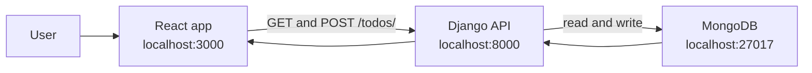

# Adbrew TODO App

This is a small TODO app running with React, Django, MongoDB, and Docker.
The user can see TODOs and add new ones. Data is saved in MongoDB.
It's my assignment , which is a part of the company's hiring process.
---

# AI clarification
At some places i've taken help of LLMs with the coding part, mainly with the writing of manual syntax part, yes. However i've tried my best to have complete overview and understanding of the same. I didnt have a lot of time to complete this since i had ~ 1 day and with my current internship it was hard to manage time so AI did help me with gaining some speed but wihout vibe coding. 
There is also a personal log markdown file where ive written some things as i progressed with the same.   
---



## What is implemented

- React shows TODOs from the API instead of hardcoded data.
- The form adds a new TODO with `POST /todos/`.
- The list loads from MongoDB with `GET /todos/`.
- The list refreshes after a TODO is added.
- React uses hooks for state and loading.
- The first TODO request can be cancelled when the page is closed.
- The UI shows loading, empty, submit, and error states.
- The API checks that the description exists, is not empty, and is no longer than 500 characters.
- The API returns clear error responses for bad input and MongoDB errors.
- MongoDB data includes an ID, description, and creation time.
- TODOs are returned with the newest TODO first.
- Backend tests cover validation, GET, POST, and MongoDB failure responses.
- The app, API, and database run in separate Docker containers.

## Project structure

- `src/app` contains the React app.
- `src/rest` contains the Django API.
- `src/rest/todos/repository.py` contains the MongoDB code.
- `src/rest/todos/validation.py` contains input checks.
- `src/rest/todos/tests.py` contains backend tests.
- `docker-compose.yml` starts the three containers.
- `Dockerfile` contains the shared container setup.

## Run the project

Set `ADBREW_CODEBASE_PATH` to the full path of the `src` folder.

PowerShell:

```powershell
$env:ADBREW_CODEBASE_PATH = "D:\path\to\adb_test\src"
docker-compose build
docker-compose up -d
```

Open these URLs:

- React app: http://localhost:3000
- TODO API: http://localhost:8000/todos/

Stop the containers:

```powershell
docker-compose down
```

View logs:

```powershell
docker logs -f --tail=100 app
docker logs -f --tail=100 api
```

## API

### Get TODOs

`GET /todos/`

Example response:

```json
{
   "todos": [
      {
         "id": "...",
         "description": "Learn Docker",
         "created_at": "2026-10-15T18:00:00+00:00"
      }
   ]
}
```

### Add a TODO

`POST /todos/`

Request body:

```json
{
   "description": "Learn Docker"
}
```

The API returns `201` when the TODO is created and `400` when the input is not valid.

## Docker note

The Docker image uses the older Debian Buster base because MongoDB 4.4 needs `libssl1.1`.
The package sources are pinned so the old MongoDB setup can still build.
Pip and apt caches are not kept in the image.
